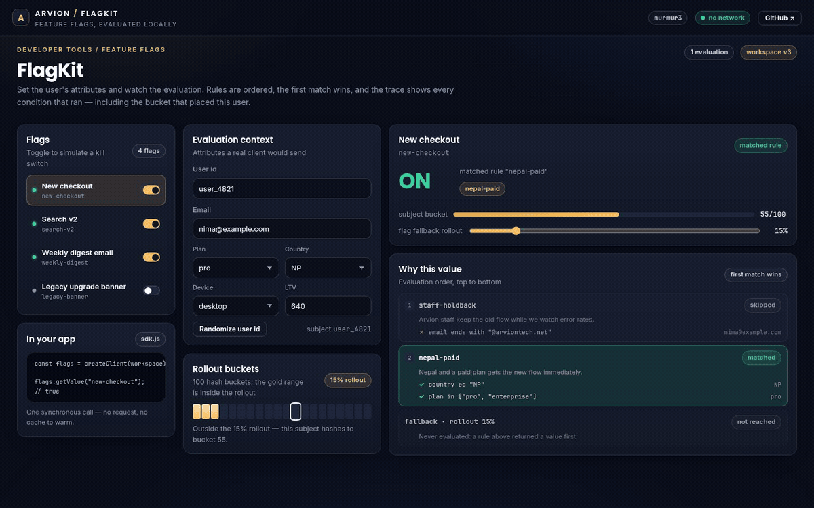
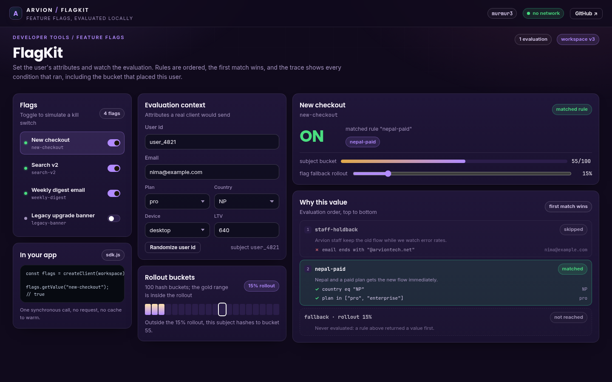

<div align="center">

</div>

<sub>Recorded from the live demo, <a href="docs/demo.mp4">MP4</a> · <a href="docs/screenshot.png">static frame</a></sub>

# FlagKit

Feature flags without a hosted service. Define flags as plain JSON, bucket users
with a stable hash, attach ordered targeting rules, schedule a rollout window,
and evaluate locally in a synchronous call. The demo shows both the value and
the trace that produced it.

[**Open the live demo**](https://arvion-technology.github.io/labs/demos/flagkit/) · [MIT](LICENSE)

---

A flag is a boolean, a string variant or an object. What makes feature flags
tricky is not returning the value; it is returning the same value twice, and
being able to explain why. FlagKit keeps the whole decision in one pure
function so the client SDK, the tests and the demo can never disagree.

## What it does

- **Stable bucketing**: MurmurHash3 (x86 32-bit) over `flag:subject`, mapped to
  100 buckets, so a user never flickers between variations.
- **Ordered targeting rules**: the first matching rule wins. Conditions
  support `eq`, `neq`, `in`, `not_in`, `contains`, `starts_with`, `ends_with`,
  `gt`, `gte`, `lt`, `lte` and `exists`.
- **AND / OR / NOT groups**: nest `{ all: [...] }`, `{ any: [...] }` and
  `{ not: ... }` to express real audiences.
- **Segments**: reusable condition groups referenced from a rule with
  `{ segment: "beta-testers" }`.
- **Percentage rollouts**: per rule or as the flag-level fallback, always
  hashed from the targeting key rather than list position.
- **Schedules**: serve the off value before `start` and after `end`.
- **Kill switch**: `enabled: false` short-circuits everything else.
- **An SDK**: `createClient(workspace).getValue(...)`, `all()`, `subscribe()`,
  `updateFlag()` and `setContext()`.
- **Validation**: a workspace with an unknown operator or a duplicate rule id
  is rejected with every problem listed, instead of evaluating to false.

## Screenshots

| Rule precedence | Segment and mobile targeting |
| --- | --- |
|  |  |

## Architecture

```text
 workspace (flags.json)
        │
        ▼
 src/validate.js ──► validateWorkspace (operators, percentages, schedules)
        │
        ▼
 src/sdk.js         createClient: snapshot, evaluate, subscribe, updateFlag
        │
        ▼
 src/evaluate.js    evaluateFlag(flag, context, { now })
        │             ├── schedule gate (before / active / after)
        │             ├── kill switch
        │             ├── ordered rules -> evaluateWhen -> condition operators
        │             └── fallback rollout
        ▼
 src/hash.js        murmur3 -> bucket(subject, { namespace })
        │
        ▼
 evaluation { value, reason, ruleId, bucket, trace }
```

`evaluateFlag` returns a trace alongside the value: one entry per rule that was
checked, with the condition leaves and their actual attribute values. The demo
renders that trace directly, which is why the highlighted rule on screen is the
rule the evaluator actually chose.

## Quickstart

```bash
git clone https://github.com/arvion-technology/flagkit.git
cd flagkit
npm test          # 34 tests, no dependencies
npm run demo      # serves the playground on http://localhost:4173
```

Defining a flag and using the SDK:

```js
import { createClient } from "./src/sdk.js";

const workspace = {
  flags: [
    {
      key: "new-checkout",
      enabled: true,
      onValue: true,
      offValue: false,
      rollout: 15,
      rules: [
        {
          id: "nepal-paid",
          description: "Nepal on a paid plan goes first",
          when: { all: [
            { attribute: "country", operator: "eq", value: "NP" },
            { attribute: "plan", operator: "in", value: ["pro", "enterprise"] },
          ] },
          value: true,
        },
      ],
    },
  ],
};

const flags = createClient(workspace);
flags.getValue("new-checkout", false, { country: "NP", plan: "pro" }); // true

const result = flags.evaluate("new-checkout", { country: "NP", plan: "pro" });
// { value: true, reason: "rule", ruleId: "nepal-paid", trace: [...] }
```

## How it works

**Bucketing is deterministic on purpose.** `murmur3("flag:new-checkout:user_4821")`
is reduced to a bucket in `[0, 100)`, and a rollout of 15% serves the on value
for buckets below 15. Different flags use different namespaces, so the same
user is not first in line for every rollout. A test hashes 50,000 subjects into
ten buckets and fails if any bucket drifts outside 8-12%, which catches a broken
hash before it reaches a customer.

**Rules are a sorted list and evaluation stops at the first match.** That makes
precedence explicit: in the sample workspace `staff-holdback` sits above
`nepal-paid`, so an Arvion address on a paid plan in Nepal gets the old checkout
even though the next rule would have matched. The trace records the skipped rule
too, so a change in ordering is visible in the UI.

**The schedule is evaluated before the rules.** A flag inside a legitimate
window continues to bucket users as normal; before the window it returns the off
value with `reason: "scheduled"`, and after it `reason: "expired"`. This matters
for campaigns: you want the same user to see the same variation when the window
opens, not a re-randomised one.

**The SDK holds a snapshot, not a connection.** `createClient` clones the
workspace, evaluates against the clock supplied to it, and exposes `subscribe`
for admin changes. There is no cache invalidation problem because there is no
cache: evaluation is a hash and a handful of comparisons. `updateFlag` replaces
one flag and notifies subscribers, which is what the demo's toggle and rollout
slider use.

## Tests

```bash
npm test
```

34 `node:test` cases in four files:

- `hash.test.js`: reference MurmurHash3 vectors, determinism, bucket range,
  namespace separation, distribution across buckets and rollouts.
- `evaluate.test.js`: first-match precedence, segments, every operator,
  nested `all`/`any`/`not`, schedule before/on/after, kill switch, rollout
  misses, trace contents and `explain()` for each reason.
- `sdk.test.js`: `getValue` fallbacks, context overrides, `all()`, subscribe/
  unsubscribe, `updateFlag`, `setContext`, copy-on-read and subscriber errors.
- `validate.test.js`: duplicate keys and rule ids, unknown operators,
  percentage bounds, unknown segments, malformed groups and schedule ordering.

`node scripts/serve-check.mjs` verifies the demo's asset references and that no
placeholder text ships.

## Limitations

The workspace is a local snapshot; there is no server, no admin API and no
audit log. Evaluation is pure JavaScript, so in a polyglot stack the Go or
Python client would need to port `murmur3` and the string format
`flag:<key>:<subject>` exactly, the README documents the format rather than
pretending a shared library exists. Segments are defined per flag instead of
workspace-wide, which keeps a flag self-contained but duplicates a segment if
many flags use it. Conditions compare strings and numbers; there is no regex
operator and no date arithmetic. The schedule uses the caller's clock.

## Project layout

```text
flagkit/
├── src/
│   ├── hash.js       # murmur3, bucket(), inRollout()
│   ├── evaluate.js   # operators, condition groups, evaluateFlag, explain
│   ├── validate.js   # workspace and flag configuration checks
│   ├── sdk.js        # createClient: evaluate, all, subscribe, updateFlag
│   └── samples.js    # the four demo flags and their rules
├── test/             # 34 node:test cases
├── demo/             # static playground, imports ../src
└── .github/workflows # CI on Node 20 and 22
```

## Credits

Built by [Arvion Technologies](https://arviontech.net) in Kathmandu as part of
our open-source [Labs](https://github.com/arvion-technology/labs) series. MIT
licensed.
